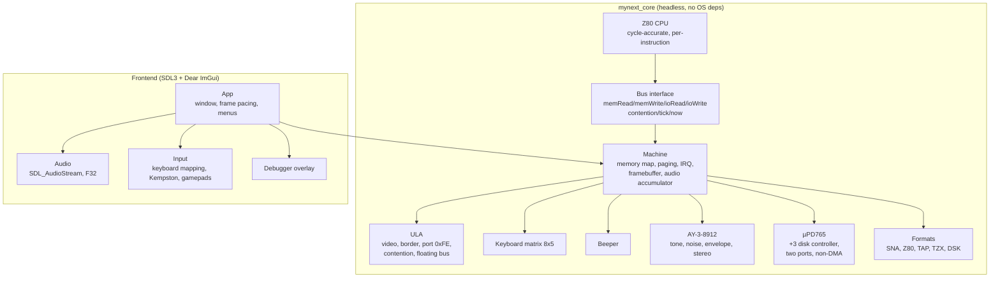

# Architecture

myNext is split into a **deterministic core** and a **thin host frontend**, the
same shape used by RustZX (`core` / `host`), JNEXT (`core` / `gui`) and
Tom Harte's CLK (processor + clocked components).



## Design rules

1. **The core never touches the OS.** No `SDL_*`, no `<filesystem>` I/O in the
   hot path, no globals, no threads. Anything platform specific lives in
   `src/frontend`. This is what makes `ctest` runnable in CI without a display
   and what makes headless golden-frame tests possible later.

2. **One master clock.** The CPU is stepped instruction by instruction and asks
   the bus for contention wait states; the ULA derives video, border and audio
   timing from the same T-state counter. Nothing is scheduled by frame or by
   scanline alone — the frame is an *emergent* property of
   `tstatesPerFrame()`.

3. **`Bus` is the only CPU↔machine contract.** `contention(addr, t)` returning
   extra T-states keeps the CPU free of Spectrum-specific knowledge and lets
   tests plug in a flat bus (`FlatBus` in `tests/test_z80.cpp`).

4. **Determinism.** Given the same ROM, the same input sequence and the same
   start state, the emulator produces the same T-state count and the same
   framebuffer. `tests/test_boot.cpp::boot_is_deterministic` guards this.

5. **Block instructions are interruptible.** `LDIR`, `CPIR`, `INIR`, `OTIR`
   execute one iteration per `step()` and rewind `PC` by two bytes, which is
   exactly what the hardware does and lets an interrupt land between
   iterations.

## Timings

Timings come from Fuse's `libspectrum/timings.c` (`base_timings`), used as a
behavioural reference only:

| Machine | CPU Hz | AY Hz | T-states/line | T-states/frame |
|---|---|---|---|---|
| 48K | 3 500 000 | — | 224 | 69 888 |
| 128K / +2 | 3 546 900 | 1 773 400 | 228 | 70 908 |
| +2A / +3 | 3 546 900 | 1 773 400 | 228 | 70 908 |
| Pentagon | 3 584 000 | 1 792 000 | 224 | 70 908 |

Contention follows the Fuse pattern `{5,4,3,2,1,0,0,6}` indexed by
`(x + 7) & 7` and only applies to `0x4000-0x7FFF` and `0xC000-0xFFFF` while the
contended bank is paged into the screen window.

## Data flow of one frame

```
runFrame()
  └─ while (frames_ < target)
       stepInstruction()
         ├─ Z80::step()  ──fetch/read/write──►  Machine::memRead/memWrite
         │                     └─ contention ──►  Machine::contention
         │                     └─ tick(n)    ──►  Machine::tick
         │                                            ├─ audioAccum_ += step * sampleRate
         │                                            ├─ borderLines_[line] = border
         │                                            └─ frame end: renderFrame()
         └─ (interrupt raised at frame start, held for interruptLength T-states)
```

## Memory map

```
0x0000-0x3FFF  ROM bank 0 or 1 (bit 4 of port 0x7FFD)
0x4000-0x7FFF  RAM bank 5 (always the contended screen bank)
0x8000-0xBFFF  RAM bank 2
0xC000-0xFFFF  RAM bank 0-7 (bits 0-2 of port 0x7FFD)
```

## Disk

The +3's µPD765 lives in `src/core/upd765.*` and talks to the CPU through the
two ports the real machine uses: `0x2FFD` (main status on read, command on
write) and `0x3FFD` (data). It is a four-phase state machine — idle, command,
execution, result — and the ROM drives it byte by byte, polling `RQM`/`DIO`
between transfers, so no timing model is needed to satisfy it.

The image is a plain `formats::DiskImage` decoded from a CPCEMU `.dsk` or an
extended `.edsk` by `src/formats/dsk.cpp`. Both containers carry a Track-Info
block per track with an eight-byte entry per sector (C, H, R, N, ST1, ST2,
length), which is exactly the CHRN tuple the controller reports in READ ID and
searches for in READ/WRITE DATA. Sectors are stored with `128 << n` bytes so a
read can hand out a fixed-size block regardless of how the image was written.

`Upd765` borrows the image instead of owning it: `Machine` holds the
`DiskImage` and re-points the controller after a load or a reset, which keeps
the controller free of I/O and lets tests construct one on the stack.

## Video pipeline

One frame is composed pixel by pixel, with sprites in a second pass.
`renderFrame()` walks the 320x256 framebuffer row by row. For each row it takes
the border colour from the ULA's recorded border byte, decodes the 256x192
bitmap into `renderUlaRow()` when the row is a screen row, and then resolves
each of the 320 columns: the ULA pixel, the tilemap pixel and the Layer 2 pixel
are all looked up for that coordinate and stacked by `layerOrder()`, which
decodes the priority table of register `0x15`.

The tilemap shares the ULA's display layer. When both cover the same pixel, the
tile's own "ULA on top" bit picks the winner; a force bit in `0x6B` overrides
it, and `0x68` bit 0 combines the two with a bitwise AND instead. Register
`0x68` bit 7 blanks the ULA without touching the tilemap, so it is applied per
pixel rather than by skipping the row.

While stacking, the composer records an `occluders_` mask: a pixel is set when
an opaque layer sits above the sprites in the priority order. `renderSprites()`
then makes a second pass over the whole surface -- sprites may reach into the
border and may sit above or below the other layers -- and skips the pixels the
mask marks as hidden. This keeps the expensive sprite scan out of the layer
loop and gives sprite-0-on-top, over-border drawing and the priority table for
free.

Every colour goes through `NextPalette`, which maps a palette index to ARGB.
The ULA and the border read the ULA palettes (register `0x43` bit 1 selects the
second one), Layer 2 reads one of its two palettes (bit 2), the sprites read
theirs (bit 3) and the tilemap picks its palette with bit 4 of `0x6B`. Bits 6:4
of `0x43` only choose where palette *writes* land.

## Sprite resolution

`Sprites::resolve()` walks the sprite list once, from sprite 0 upwards, and
turns the raw attribute bytes into a `SpriteState` per sprite: position,
pattern number, palette offset, pattern size, mirror, rotate and scale. A
sprite whose byte 4 has its top two bits at `01` is *relative*: instead of
carrying a position it carries signed offsets from the anchor that precedes it,
and it borrows the anchor's pattern size and optionally adds the anchor's
pattern (`PO`) and palette offset (`PR`). An anchor whose byte 4 has bit 5 set
is *unified*: its relatives are parts of one big sprite, so they also copy the
anchor's mirror, rotate and scale, and their offsets are scaled and turned with
the anchor. Rendering then works purely from the resolved states, which keeps
the relative logic in one place.

`renderSprites()` also maintains the two flags of the status port `0x303B`.
Collisions come from a bit-per-pixel `spriteDrawn_` map: a sprite that writes
over a pixel another sprite already drew raises the collision flag. The budget
check is a pre-pass that counts how many sprites cover each of the 256
scanlines; the hundredth sprite on a line is the last one that fits, and
anything past it is dropped from the frame and raises the overflow flag. Both
flags clear themselves when the port is read, so a program can poll them per
frame without a separate reset.

## Frame buffer

`Machine::framebuffer()` is `320x256` ARGB8888: a 32-pixel border around a
`256x192` screen. The frontend uploads it as an SDL streaming texture, so a
shader-based CRT filter can be dropped in later without touching the core.

## Adding a machine

1. Add an entry to `MachineType` and a row to `timingsFor()`.
2. Extend `Machine::memRead` / `memWrite` / `ioRead` / `ioWrite` for new paging
   or peripherals.
3. Add a unit test next to `tests/test_ula.cpp` that asserts the T-state count
   of one frame.
