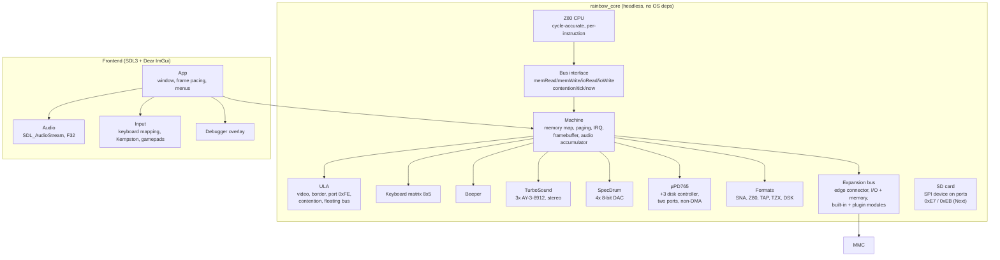

# Architecture

RainbowNext is split into a **deterministic core** and a **thin host frontend**, the
same shape used by RustZX (`core` / `host`), JNEXT (`core` / `gui`) and
Tom Harte's CLK (processor + clocked components).



## Design rules

1. **The core never touches the OS.** No `SDL_*`, no `<filesystem>` I/O in the
   hot path, no globals, no threads. Anything platform specific lives in
   `src/frontend`. This is what makes `ctest` runnable in CI without a display
   and what makes headless golden-frame tests possible later.

2. **One master clock.** The CPU is stepped instruction by instruction and asks
   the bus for contention wait states; the ULA derives video, border and audio
   timing from the same T-state counter. Nothing is scheduled by frame or by
   scanline alone — the frame is an *emergent* property of
   `tstatesPerFrame()`.

3. **`Bus` is the only CPU↔machine contract.** `contention(addr, t)` returning
   extra T-states keeps the CPU free of Spectrum-specific knowledge and lets
   tests plug in a flat bus (`FlatBus` in `tests/test_z80.cpp`).

4. **Determinism.** Given the same ROM, the same input sequence and the same
   start state, the emulator produces the same T-state count and the same
   framebuffer. `tests/test_boot.cpp::boot_is_deterministic` guards this.

5. **Block instructions are interruptible.** `LDIR`, `CPIR`, `INIR`, `OTIR`
   execute one iteration per `step()` and rewind `PC` by two bytes, which is
   exactly what the hardware does and lets an interrupt land between
   iterations.

## Expansion bus

The Spectrum had its expansion on the edge connector, and RainbowNext keeps that
shape: `src/core/peripheral.h` is the contract a device implements,
`src/core/expansion.h` is the bus that owns the devices, and `Machine` routes
every access through it. Nothing in the machine knows which modules exist, so
adding a joystick interface, a printer, a cartridge or a mass-storage interface
never touches the core.

There are two levels of module, and the difference is only who compiles them:

* **Built-in** (`src/peripherals/`) are compiled into `rainbow_core`, created by
  a factory in `Machine::installPeripherals()` and type-safe. They can reach the
  rest of the core directly when they need to; `kempston`, `kempston-mouse`,
  `printer` and `cartridge` ship this way.
* **Plugins** are shared libraries (`.dylib` / `.so` / `.dll`) in a folder next
  to the executable, found at startup and after `Rescan plugin folder`. They
  talk to the emulator through the plain C ABI of `src/plugin/plugin_api.h` and
  are not linked against it, so one can be written, rebuilt and dropped in
  without touching the emulator — `plugins/fuller/fuller.cpp` is a complete
  example. A plugin that fails to load is reported in the menu and skipped;
  one broken library never stops the others.

`Peripheral` is deliberately small. A module declares `info()` (an id, a name, a
description and the ports it decodes), and may implement `reset()`,
`enable()`, `disable()`, `ioRead()`, `ioWrite()`, `rom()`, `tick()`,
`fileFilter()` and `loadFile()`.

`ioRead()`/`ioWrite()` return **true when the module owns the access** and false
to pass it on. The bus offers each access to the enabled modules in the order
they were plugged in — a real daisy chain — and whatever nobody claims reaches
`Machine::ioReadBase()`. That boolean is what lets the printer *watch* port
`0xFB` without stealing it from the ULA, and what lets a module sit behind
another one.

`HostServices` is the module's way back into the machine: callbacks for port and
memory reads, NextREG access and the current joystick state. The callbacks go to
`ioReadBase()`/`memRead()` directly, never back through the bus, so a module
cannot recurse into itself by reading a port it claims. The bus hands the same
address out to everyone, so a module may keep the pointer.

`rom()` is how a cartridge takes over the bottom 16K: the machine maps the first
enabled module that returns an image at `0x0000` and ignores its own ROM while
that module is plugged in. The bus fires an observer after anything that changes
what the modules contribute, and `Machine::refreshCartridge()` re-reads the image
then rather than on every access.

### Memory, and the M1 cycle

Ports are not enough for everything. A mass-storage interface such as the
DivMMC or DivIDE maps itself over the bottom 8K, and — this is the part that
shapes the contract — it maps in on its *own*, in the middle of an opcode fetch,
whenever the CPU executes a byte at one of a handful of hook addresses. A driver
that never writes to the control port still gets its NMI handler. No module
ships that does this today; the memory half of the contract exists so one can.

So a module opts into memory with `interceptsMemory()`, and the bus keeps a
separate list of the modules that said yes. `Machine::memRead()` and
`memWrite()` consult that list before the base memory, and pay nothing when it
is empty. The three memory methods are:

* `memRead(addr, t, m1, value)` — `m1` is true only for an opcode fetch, so a
  module can tell "the CPU is executing here" from "the CPU is reading a byte
  here". That distinction is the whole automap.
* `memFetch(addr, t)` — the machine's version, called from `Z80::fetch()` via
  `Bus::memFetch()`, which defaults to `memRead()` so a module that does not care
  only implements one of them.
* `memWrite(addr, value, t)` — claimed the same way, which is what lets a module
  hide the machine's RAM behind its own.

`true` means the module answered and the access stops there; `false` falls
through to the next module and then to the machine. Because a module can claim
an address and still decline to store anything — a ROM window is read-only —
the boolean means "mine", not "changed".

The bus owns its modules and knows nothing about `Machine`, so a test can build
one, plug in a fake module and drive it without a CPU or a ROM — see
`tests/test_expansion.cpp` and the `SpiBus` harness in
`tests/test_sdcard.cpp`.

## The SD card

`src/core/sdcard.*` is a plain sector image in memory with the SPI state machine
in front of it, which is why it is testable without a file. It is **not** a
peripheral and has no ports of its own: `Machine` owns it and exposes
`sdCard()`, and whoever brings the bus wiring decides which ports reach it. On
the Next that is the built-in interface described below; a DivMMC-style module,
if one is ever written, would share the same object through its own `0xDF`.

A driver sends a six-byte command frame (`0x40 | cmd`, four argument bytes, a
CRC that SPI mode ignores) and reads an R1 back; `CMD0`, `CMD8`, `CMD9`,
`CMD10`, `CMD12`, `CMD13`, `CMD16`, `CMD17`, `CMD18`, `CMD23`, `CMD24`,
`CMD25`, `CMD55`+`ACMD41`, `CMD58` and `CMD59` are answered, and everything else
gets the illegal-command bit. The card only claims SDHC, and with it block
addressing, when the image really is larger than 2 GiB *and* `ACMD41` set the
HCS bit; a smaller image stays a byte-addressed SDSC card even when the host
asks for high capacity, which is what a real card does and what keeps a 32 KiB
test image from being mistaken for an SDHC one. The `CSD` and `CID` are built to
match, version 2.0 for SDHC and version 1.0 for SDSC, both with a real CRC7 in
the last byte, because the `CSD` is the one field a driver sanity-checks.

`CMD18` streams: the next block is generated on demand as the driver clocks
bytes out, so a multi-block read of a 64M image never copies it. `CMD25`
collects the blocks until the `0xFD` stop token and answers with the usual
data-response token. `CMD12` aborts either direction.

One detail catches out every new test: a response is delivered **one clock
late**. The byte that finishes the command frame is still part of the frame, so
the R1 appears on the *next* transfer. Likewise the card only leaves its
response state on a clock, so a driver wastes a few `0xFF` bytes before starting
the next frame. Real drivers are written that way anyway.

### The Next's built-in interface

The Next does not need a module to reach a card. Port `0xE7` is the chip select
and `0xEB` is the data register, both decoded in `Machine::ioReadBase()` /
`ioWriteBase()` under `isNext()`:

| Port | Direction | Meaning |
|---|---|---|
| `0xE7` | write | chip select, **active low per device**: bit 0 = SD card 0, bit 1 = SD card 1, bit 2/3 = the Pi's two SPI sockets, bit 7 = the FPGA's config flash. Only one bit may be low. |
| `0xE7` | read | the latch last written |
| `0xEB` | any | one byte through the card: a write clocks it out, a read clocks `0xFF` in and returns what came back |

The emulator computes `~value & 0x0F` and selects the card only when that is
`0x01` or `0x02`, so the Pi's sockets cannot reach it. Masking with `0x0F`
rather than `0x03` is deliberate: it keeps bit 7 (the flash) from looking like a
selection too.

This is not a guess about the hardware — the boot ROM's own SD driver uses it.
In `next.rom` page 2 the routine at `0x18D6` does `LD A,0xFE / OUT (0xE7),A`
for card 0 and `0xFD` for card 1, then streams with `IN A,(0xEB)` and the
`ED 79` block-transfer form with `C=0xEB`. There are sixteen `IN A,(0xEB)` and
three `OUT (0xEB),A` in that page alone.

### divMMC, and why it is not a plugin

divMMC is part of the Next, in `src/core/divmmc.*`. It is not a cartridge and it
does not own a card: `Machine` keeps one `SdCard` and divMMC only maps ROM and
RAM over the bottom of the address space.

The reason is not sentiment. The boot ROM at `0x1EDB` writes `OUT (0xE3),A` to
map the card ROM over `0x0000` and then checks `0x0004` for the `"DV"`
signature; `nxtmmc.rom` starts `F3 C3 6A 00 44 56 09 02`, which puts `44 56`
exactly there. When the check fails the ROM spins at `JR 0x1ED9` and nothing
ever boots. The card ROM is also where the esxDOS block-read driver lives
(`0x1F0F`-`0x1F5C`), so it is the code path that actually reads NextZXOS off the
card.

What is modelled:

| Piece | Detail |
|---|---|
| `0xE3` latch | bit 7 `CONMEM` maps the ROM over `0x0000`, bit 6 `MAPRAM` puts RAM bank 3 over the ROM half, bits 2:0 pick the bank |
| ROM | one 8 KiB page of a 32 KiB image; the top half (`0x2000`-`0x3FFF`) is read-only ROM, the bottom half RAM once `CONMEM` is set |
| RAM | 16 x 8 KiB banks, cleared only by a power-on reset |
| automap | NextReg `0x0A` bit 4 is the master switch; an entry point only fires on an M1 fetch, and the `0x0066`/`0x04C6`/`0x04D7`/`0x0562`/`0x056A` set also requires ROM3 to be paged in |
| entry points | NextReg `0xB8`-`0xBB`: the set-0 bitmap, its valid mask, its timing byte, and the set-1 bitmap |
| exit stub | a `RET` to an entry point unmaps after that instruction |

For classic machines divMMC stays what it always was: optional, and not part of
`Machine`. The `Peripheral` contract still has its memory hooks, so a module can
map itself over the bottom of memory without the core knowing what it is.

The frontend offers **Tools > Insert SD card image...** and `--sd FILE`; a
dropped `.img` or `.mmc` does the same. The image is owned by `Machine`, so
switching the machine type rebuilds the bus without ejecting the card, and the
path picked in **Machine > ROM images...** is written to `rainbow.cfg` so the
next start comes up with it already in.

## Timings

Timings come from Fuse's `libspectrum/timings.c` (`base_timings`), used as a
behavioural reference only:

| Machine | CPU Hz | AY Hz | T-states/line | T-states/frame |
|---|---|---|---|---|
| 48K | 3 500 000 | — | 224 | 69 888 |
| 128K / +2 | 3 546 900 | 1 773 400 | 228 | 70 908 |
| +2A / +3 | 3 546 900 | 1 773 400 | 228 | 70 908 |
| Pentagon | 3 584 000 | 1 792 000 | 224 | 71 680 |

Contention follows the pattern `{6,5,4,3,2,1,0,0}`: six busy T-states and two
idle ones out of every eight, because the ULA fetches two pixels per T-state.
The cycle is anchored to the first T-state of the display window and then
indexed by the absolute T-state, which is what makes the machines differ. The
48K line is 224 T-states, a multiple of eight, so every line meets the same
phase; the 128K, the +3 and the Next line is 228, so their phase advances by
four and the first pixel alternates between six and two T-states of delay.

Contention applies to `0x4000-0x7FFF` always, and to `0xC000-0xFFFF` only while
a contended bank is paged into the screen window: the 128K and the grey +2
contend on the odd banks alone, because the gate array cannot see the even ones,
while the +2A/+3 ASIC contends whatever bank it puts there. The Pentagon has no
contention at all.

## Data flow of one frame

```
runFrame()
  └─ while (frames_ < target)
       stepInstruction()
         ├─ Z80::step()  ──fetch/read/write──►  Machine::memRead/memWrite
         │                     └─ contention ──►  Machine::contention
         │                     └─ tick(n)    ──►  Machine::tick
         │                                            ├─ audioAccum_ += step * sampleRate
         │                                            ├─ borderLines_[line] = border
         │                                            └─ frame end: renderFrame()
         └─ (interrupt raised at frame start, held for interruptLength T-states)
```

## Memory map

```
0x0000-0x3FFF  ROM bank 0 or 1 (bit 4 of port 0x7FFD)
0x4000-0x7FFF  RAM bank 5 (always the contended screen bank)
0x8000-0xBFFF  RAM bank 2
0xC000-0xFFFF  RAM bank 0-7 (bits 0-2 of port 0x7FFD)
```

## Programs and snapshots

`.sna` and `.z80` are snapshots of a running classic machine: CPU registers, up
to 128K of RAM, the border and `0x7FFD`. They land in a `formats::Snapshot` and
`Machine::applySnapshot` copies it straight in.

`.nex` is a different shape. It is a program image for the Next: the 16K RAM
banks it wants, an optional 256-entry palette, optional loading screens, and the
register state its author assumes. `src/formats/nex.cpp` only parses the file
into a `formats::NexFile` and leaves the hardware alone; `Machine::applyNex`
does the rest, in the order the official `nexload` uses:

1. reset, because a `.nex` describes a whole machine, not a delta;
2. unless `preserveNextRegs` is set, the register state `nexload` leaves behind
   — Copper stopped, 28 MHz, Layer 2 on bank 9, clip windows full-screen, and
   the ULA palette filled with its sixteen defaults while the Layer 2 and sprite
   palettes are blanked;
3. the palette block into the Layer 2 first palette;
4. the loading screens, with the Layer 2 one spread over banks 9, 10 and 11 and
   the ULA one at the top of bank 5;
5. the banks, so a bank that shares memory with a loading screen wins;
6. the entry bank through MMU slots 6 and 7, then `PC` and `SP`.

The banks are read in the order `nexload` reads them — 5, 2 and 0 first because
it can show a screen straight out of those, then the rest ascending — and the
file's declared bank count is not trusted; the per-bank flags are.

Because a `.nex` carries NextReg state and 2 MB of RAM, loading one switches the
machine to the Next first. The loading screen is applied as memory and not
animated: the `loadingBar` and delay fields are parsed but nothing draws a
progress bar, which is a determinism win and a fidelity loss noted in the
roadmap.

## Save states

`src/core/state.h` is a two-ended stream: `StateWriter` appends fields,
`StateReader` consumes them, and `Machine::serialize` is one template that both
of them call. Writing a field the reader does not know about is therefore not
possible — the same line of code does both directions — which is the property
that keeps a state format from rotting.

The file is:

```
RBNSTATE         8 bytes, magic
version          u32, bump when the field order changes
machine type     u8, MachineType
rom loaded       u8
ROM fingerprint  u64, FNV-1a over the ROM image
body             every subsystem, RAM, framebuffer and the paging registers
checksum         u64, FNV-1a over everything above
```

`loadState` verifies the size, magic and checksum before it reads a single
field, then the version, the machine type and the ROM fingerprint. The body is
parsed twice — once into a scratch machine to prove the whole of it reads, then
for real — so a file that is wrong anywhere leaves the machine exactly as it
was rather than half-rewritten. The scratch pass also insists that the body is
consumed to the last byte, which is what catches a field added without a
version bump.

What is stored and what is not follows one rule: **state is stored, derivatives
are not.** RAM, the framebuffer and the border colour are state; the resolved
page table (`page_`), the audio mix buffer, the sprite collision scratch and the
turbo accumulator are recomputed by `updatePaging()` and the next frame, so a
state can never disagree with itself. Tapes, disks and the SD card image are
user-supplied files of unbounded size and are not embedded: a state records the
tape head position and the frontend keeps the media attached.

The ROM is fingerprinted rather than stored. It is the user's file, it is large,
and a state restored against a different ROM would run code the state never saw.

`src/core/rewind.*` is a ring of those same states, bounded by bytes rather than
by a count because a 48K state is a few hundred kilobytes and a Next state a few
megabytes. `App` pushes one every four frames; `F10` pops one and loads it, which
is what makes rewinding a matter of arithmetic rather than a second emulator.

## RZX replay

`src/core/rzx.*` is the container and `src/core/rzx_session.*` is the session
that makes one. The format is the one libspectrum and Fuse read, which is the
only description of it that exists: a ten-byte `RZX!` header, then blocks of a
one-byte identifier and a 32-bit length that counts its own five header bytes.

```
0x10  CREATOR   20-byte program name, major and minor words
0x20  SIGN_START    \
0x21  SIGN_END      / signature blocks, skipped
0x30  SNAPSHOT  flags, a four-character format name, length, data
0x80  INPUT     frame count, T-states, flags, then frames
```

An input frame is a 16-bit instruction count, a 16-bit byte count and that many
bytes; a count of `0xFFFF` means "repeat the previous frame", which is how a
still screen costs four bytes instead of thousands.

What the bytes are is the whole idea of the format: each one is the value a port
read returned, in the order the CPU asked for them. RZX does not record the
keyboard. It records what the machine saw, so a replay does not care what the
host is doing — which is why a session has to sit on the machine's I/O path and
not on the input layer. `Machine::ioRead` takes an `IoReadHook` and calls it with
the value it is about to return; in record mode the session appends that value
to the current frame, in play mode it returns the recorded one instead.

A recording therefore starts with a snapshot, taken at a frame boundary, and the
input stream only means anything when replayed onto it. That snapshot goes into
the file's `SNAPSHOT` block under the four-character name `RBNS`, which is our
own state format: `Machine::loadState` reads it back exactly, and no translation
from `SNA` or `SZX` has to be invented. The cost is that other emulators cannot
open a RainbowNext RZX, which is a deliberate trade for a replay that is right
rather than approximately right.

Blocks are written uncompressed. Compression is optional in the format — the
flag simply stays clear — and skipping it keeps zlib out of the dependency list.
A file is dominated by its snapshot, so a 48K recording is about 2.4 MB however
many frames it holds.

`App` drives the session one frame at a time: `runFrame()` then
`RzxSession::frameFinished()`. A frame cut short by a breakpoint or a pause is
dropped instead of half-written. A replay that runs out of frames switches itself
off and pauses the emulator. Reads the recording has no byte for, and bytes it
stored that the machine never asked for, are counted as desyncs rather than
treated as fatal: the run continues and the count says whether it was the one
that was recorded.

## Disk

The +3's µPD765 lives in `src/core/upd765.*` and talks to the CPU through the
two ports the real machine uses: `0x2FFD` (main status on read, command on
write) and `0x3FFD` (data). It is a four-phase state machine — idle, command,
execution, result — and the ROM drives it byte by byte, polling `RQM`/`DIO`
between transfers, so no timing model is needed to satisfy it.

The image is a plain `formats::DiskImage` decoded from a CPCEMU `.dsk` or an
extended `.edsk` by `src/formats/dsk.cpp`. Both containers carry a Track-Info
block per track with an eight-byte entry per sector (C, H, R, N, ST1, ST2,
length), which is exactly the CHRN tuple the controller reports in READ ID and
searches for in READ/WRITE DATA. Sectors are stored with `128 << n` bytes so a
read can hand out a fixed-size block regardless of how the image was written.

A raw TR-DOS `.trd` needs no decoder at all: it carries no header, so the
geometry is fixed at 80 cylinders, two sides and sixteen 256-byte sectors per
track, and the file is exactly those sectors in physical order. `parseTrd`
synthesises the same `DiskImage` with sector ids 1..16, which is what the
controller reports and the TR-DOS ROM asks for. `loadDiskFile` dispatches on the
extension so the rest of the code never has to know which container it was
handed.

`Upd765` borrows the image instead of owning it: `Machine` holds the
`DiskImage` and re-points the controller after a load or a reset, which keeps
the controller free of I/O and lets tests construct one on the stack.

## Video pipeline

One frame is composed pixel by pixel, scanline by scanline.
`renderFrame()` walks the 320x256 framebuffer row by row. For each row it maps
the framebuffer row back to its raster line with `rasterLineFor()`, hands that
line to the Copper, and then samples the layer registers -- the priority table
of `0x15`, the ULA blanking bit of `0x68`, the tilemap view, the Layer 2 view
and the recorded border byte. Sampling per scanline is what lets the Copper
change a colour, a scroll offset or a priority partway down the frame: the
change is visible from the line it was made on.

The row itself is then resolved column by column: the ULA pixel (decoded into
`ulaRow` by `renderUlaRow()` when the row is a screen row), the tilemap pixel
and the Layer 2 pixel are all looked up for that coordinate and stacked by
`layerOrder()`, which decodes the priority table of register `0x15`.

The tilemap shares the ULA's display layer. When both cover the same pixel, the
tile's own "ULA on top" bit picks the winner; a force bit in `0x6B` overrides
it, and `0x68` bit 0 combines the two with a bitwise AND instead. Register
`0x68` bit 7 blanks the ULA without touching the tilemap, so it is applied per
pixel rather than by skipping the row.

While stacking, the composer records an `occluders_` mask: a pixel is set when
an opaque layer sits above the sprites in the priority order. `renderSpriteRow()`
then makes a second pass over that one row -- sprites may reach into the border
and may sit above or below the other layers -- and skips the pixels the mask
marks as hidden. This keeps the expensive sprite scan out of the layer loop and
gives sprite-0-on-top, over-border drawing and the priority table for free. The
`0x303B` collision map is one scanline wide for the same reason: it is filled
while the row is drawn and cleared for the next one.

Every colour goes through `NextPalette`, which maps a palette index to ARGB.
The ULA and the border read the ULA palettes (register `0x43` bit 1 selects the
second one), Layer 2 reads one of its two palettes (bit 2), the sprites read
theirs (bit 3) and the tilemap picks its palette with bit 4 of `0x6B`. Bits 6:4
of `0x43` only choose where palette *writes* land.

## Sprite resolution

`Sprites::resolve()` walks the sprite list once, from sprite 0 upwards, and
turns the raw attribute bytes into a `SpriteState` per sprite: position,
pattern number, palette offset, pattern size, mirror, rotate and scale. A
sprite whose byte 4 has its top two bits at `01` is *relative*: instead of
carrying a position it carries signed offsets from the anchor that precedes it,
and it borrows the anchor's pattern size and optionally adds the anchor's
pattern (`PO`) and palette offset (`PR`). An anchor whose byte 4 has bit 5 set
is *unified*: its relatives are parts of one big sprite, so they also copy the
anchor's mirror, rotate and scale, and their offsets are scaled and turned with
the anchor. Rendering then works purely from the resolved states, which keeps
the relative logic in one place.

`renderSpriteRow()` also maintains the two flags of the status port `0x303B`.
Collisions come from a bit-per-pixel `spriteDrawn_` map, one scanline wide and
cleared as the row starts: a sprite that writes over a pixel another sprite
already drew raises the collision flag. The budget check counts how many sprites
cover the row being drawn; the hundredth sprite on a line is the last one that
fits, and anything past it is dropped from the frame and raises the overflow
flag. Both flags clear themselves when the port is read, so a program can poll
them per frame without a separate reset.

## Copper

The Copper lives in `src/core/copper.*` and is the machine's own small
coprocessor rather than part of the CPU: it has 2K of program memory, addressed
as 1024 two-byte instructions, and a ten-bit program counter that wraps back to
the start. `Machine::renderFrame()` calls `Copper::runToLine()` with the raster
line it is about to draw, and the Copper runs until it blocks on a `WAIT` for a
later line, calling back into `writeNextReg()` for every `MOVE`. That callback
is the whole interface, which keeps the Copper independent of the machine and
lets tests drive it with a recording lambda.

The instruction word shares one bit between the two opcodes: `1hhhhhhv vvvvvvvv`
is a `WAIT` for line `v` at horizontal position `h*8`, and `0rrrrrrr vvvvvvvv`
is a `MOVE` of `v` into Next register `r`. `0x0000` is a no-op, and `0xFFFF`
waits for a line past the end of the frame, which is how a program halts. The
run loop is bounded to one pass over the program so a program without waits
cannot stall the frame.

Register `0x61` holds the low byte of the write index and bits 2:0 of `0x62`
its top three bits; bits 7:6 of `0x62` are the mode -- stop, restart, continue,
or restart every frame. A control write whose mode bits match the previous
value only moves the write index, so a program can be uploaded while it is
running. `0x63` takes a word as two writes, high byte then low byte, and
commits it only when the second one arrives, so a half-written instruction is
never executed.

The horizontal position of a `WAIT` is decoded and kept, but the compositor
samples the register file once per scanline, so it does not delay the
instruction past the start of its line. That is the one deliberate
simplification in the model; it is what the pixel-accurate version would need
mid-line register sampling for.

## DMA

`src/core/dma.*` is the zxnDMA, one channel that can copy a block between two
addresses where either side may be memory or an IO port. Like the Copper it
does not know about `Machine`: the constructor of the machine hands it two
`std::function` callbacks that read and write a byte through `memRead`,
`memWrite`, `ioRead` or `ioWrite`, so a test can drive it against a flat buffer
and count the accesses.

The CPU writes the control bytes into `0x6B` (or `0x0B` for the Zilog
compatibility port, which moves one byte more than the programmed length) and
the device decodes them in the order the datasheet expects: a base register
byte first, then the parameter bytes that its bits requested. `WR0` carries the
direction and the requests for the start address of port A and the length,
`WR1` and `WR2` describe port A and its timing, `WR4` describes port B, `WR5`
holds auto restart, and `WR6` is a command. The parameter list is reset by every
base byte, which is what makes an interrupted sequence harmless.

`LOAD` copies the programmed start addresses into the live pointers and the
length into the counter; `ENABLE` starts the transfer. Without a prescalar the
whole block is copied inside the `ENABLE` write, because the DMA is faster than
the CPU and the block always finishes before the next instruction. With a
prescalar the transfer becomes asynchronous: `Machine::tick()` calls
`ZxnDma::advance()` with the elapsed master clocks, and a byte moves every
`32 * prescalar` of them, which is the 875 kHz of the datasheet divided down.
That is the mode a program uses to stream samples to the DAC while the CPU
keeps running.

At the end of a block the end-of-block flag of the status byte is cleared, and
either auto restart rewinds the pointers and the counter for the next block or
the channel disables itself. Reading `0x6B` returns a sequence of seven bytes --
status, counter, port A, port B -- masked by the read mask, which `WR6` can
narrow so a program polls only the status byte. The read index wraps, so a
program that reads past the end of its mask starts over instead of reading
garbage.

## Sound

`src/core/ay.*` is one AY-3-8912: three tone dividers, a 17-bit noise LFSR, a
16-step envelope and a 4-bit volume per channel. It has no clock of its own --
`Machine::tick()` hands it the elapsed T-states and it divides them down to its
1.75 MHz, so the same program always produces the same samples. The stereo
modes `Mono`, `ABC` and `ACB` are a property of the mixer, not of the chip:
`sampleLeft()` and `sampleRight()` weight the three channel outputs by 1.0 for
the outer ones and 0.5 for the middle one, so `ACB` swaps which channel is
attenuated.

`src/core/turbosound.*` owns three of those chips and the Next additions on top
of them. A write to `0xFFFD` with bit 7 set selects a chip instead of a
register: bits 1:0 pick it (`11` first, `10` second, `01` third), bit 6 gates
its left output and bit 5 its right one, which is how a program pans a single
chip without touching the shared stereo mode. With bit 7 clear the byte is an
ordinary register number for the selected chip, and `0xBFFD` reads and writes
that register's data. Chip select only exists on the Next, so on a 128 or a +3
bit 7 stays part of the register number.

NextReg `0x08` bit 1 enables the second and third chip, and while they are off
`tick()` freezes them rather than muting them, so a program that switches them
on later finds them exactly where it left them; bit 5 chooses between the `ABC`
and the `ACB` layout. NextReg `0x09` bits 7:5 force a chip to mono, which folds
its left and right outputs together.

`src/core/dac.*` is the four 8-bit DACs of the SpecDrum and SoundDrive. They
have no timing at all: a write latches a level and it stays there until the
next write, which is what lets the CPU, or the DMA streaming into `0x0B`, drive
them at its own pace. The port's low byte decides which DACs a write reaches --
`0x1F` is A, `0x0F` is B, `0x4F` is C, `0x5F` is D, `0xDF` is A and D together
(the centre channel a mono SpecDrum sample wants) and `0xB3` is B and C -- and
NextReg `0x2C`, `0x2D` and `0x2E` mirror B, A+D and C for a program that would
rather not touch an IO port. A and B mix into the left output, C and D into the
right, each pair averaged so that a single DAC cannot clip the mix.

`Machine::tick()` advances the audio accumulator too, and every time it passes
a sample period it sums the beeper, the TurboSound and, on the Next, the DACs,
runs the result through a one-pole high pass that removes the standing level --
the speaker is AC coupled, so without it a silent AY would sit against a rail --
clamps it to `[-1, 1]` and appends the left/right pair to `audioBuffer()`. That
buffer keeps the last two seconds so a stalled frontend does not lose the
stream, and the frontend drains it into an `SDL_AudioStream` that resamples to
whatever the device wants.

## Frame buffer

`Machine::framebuffer()` is `320x256` ARGB8888: a 32-pixel border around a
`256x192` screen. The core never talks to the GPU; it only hands the frontend a
pointer to that array.

## Screen renderer

`frontend/screen.cpp` owns the SDL_GPU device and everything drawn with it.
Every frame it uploads the framebuffer into a `B8G8R8A8_UNORM` texture through a
transfer buffer and draws a single triangle over the letterboxed destination
rectangle. The vertex shader positions that triangle from a uniform block
(`dest`, `surface`, `params`), so there is no vertex buffer and no per-frame
allocation; the fragment shader samples the picture with a nearest-neighbour
sampler and, when the CRT pass is on, multiplies in a seam at the edge of every
source line and a three-pixel aperture grille.

The shaders live in `src/frontend/shaders/` as GLSL and are compiled by
`build.sh` into `crt_shaders.h`, which holds both SPIR-V and MSL. SDL_GPU picks
whichever its driver understands, so the same source serves Metal and Vulkan,
and a normal build never needs `glslang` or `spirv-cross`.

ImGui renders into the same pass through `imgui_impl_sdlgpu3`, which means the
overlay is composited by the GPU instead of a second renderer. Note that
SDL_GPU's clip space has +Y up while the layout maths works in viewport pixels
with +Y down, so `crt.vert` flips the vertical axis itself.

## Input and handhelds

`frontend/input.cpp` is the only place the host's devices meet the machine. The
host keyboard is translated into row/column pairs of the 8x5 matrix by a static
table, and the arrow keys and Ctrl are merged into the Kempston byte, which the
main loop pushes with `Machine::setKempston` once a frame. The Kempston value is
live host input and is deliberately not part of a save state.

A gamepad feeds both paths at once: the left stick and the d-pad set Kempston
directions, A and B fire, and four buttons press matrix keys (`X` SPACE, `Y`
ENTER, `LB` CAPS SHIFT, `RB` SYMBOL SHIFT), because plenty of Spectrum software
only ever reads the matrix. Those keys go through `Keyboard::setPadKey`, a layer
kept apart from the matrix so that letting go of the pad cannot clear a key the
keyboard is still holding. `Start` and `Back` are not machine buttons: they come
back from `Input::pollGamepads` as a one-shot `PadAction` that the loop turns
into "summon the toolbar" and "pause".

The window is sized from `SDL_GetDisplayUsableBounds` to the largest whole-number
zoom of the 320x256 frame that fits (capped at 3x), which keeps every Spectrum
pixel the same size and square. A panel that reports 1280x800, or a process that
inherits `SteamDeck=1`, starts fullscreen instead: a handheld has no window
manager to place a window with, and Esc or F11 brings it back.

## Adding a machine

1. Add an entry to `MachineType` and a row to `timingsFor()`.
2. Extend `Machine::memRead` / `memWrite` / `ioRead` / `ioWrite` for new paging
   or peripherals.
3. Add a unit test next to `tests/test_ula.cpp` that asserts the T-state count
   of one frame.
