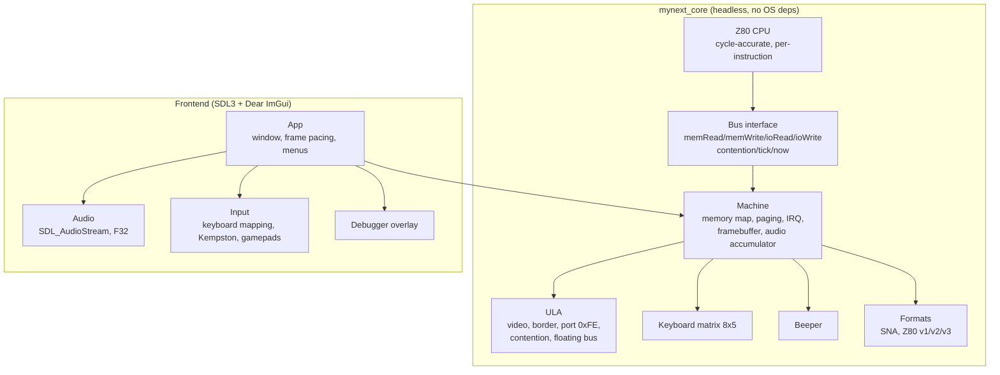

# Architecture

myNext is split into a **deterministic core** and a **thin host frontend**, the
same shape used by RustZX (`core` / `host`), JNEXT (`core` / `gui`) and
Tom Harte's CLK (processor + clocked components).



## Design rules

1. **The core never touches the OS.** No `SDL_*`, no `<filesystem>` I/O in the
   hot path, no globals, no threads. Anything platform specific lives in
   `src/frontend`. This is what makes `ctest` runnable in CI without a display
   and what makes headless golden-frame tests possible later.

2. **One master clock.** The CPU is stepped instruction by instruction and asks
   the bus for contention wait states; the ULA derives video, border and audio
   timing from the same T-state counter. Nothing is scheduled by frame or by
   scanline alone — the frame is an *emergent* property of
   `tstatesPerFrame()`.

3. **`Bus` is the only CPU↔machine contract.** `contention(addr, t)` returning
   extra T-states keeps the CPU free of Spectrum-specific knowledge and lets
   tests plug in a flat bus (`FlatBus` in `tests/test_z80.cpp`).

4. **Determinism.** Given the same ROM, the same input sequence and the same
   start state, the emulator produces the same T-state count and the same
   framebuffer. `tests/test_boot.cpp::boot_is_deterministic` guards this.

5. **Block instructions are interruptible.** `LDIR`, `CPIR`, `INIR`, `OTIR`
   execute one iteration per `step()` and rewind `PC` by two bytes, which is
   exactly what the hardware does and lets an interrupt land between
   iterations.

## Timings

Timings come from Fuse's `libspectrum/timings.c` (`base_timings`), used as a
behavioural reference only:

| Machine | CPU Hz | AY Hz | T-states/line | T-states/frame |
|---|---|---|---|---|
| 48K | 3 500 000 | — | 224 | 69 888 |
| 128K / +2 | 3 546 900 | 1 773 400 | 228 | 70 908 |
| +2A / +3 | 3 546 900 | 1 773 400 | 228 | 70 908 |
| Pentagon | 3 584 000 | 1 792 000 | 224 | 70 908 |

Contention follows the Fuse pattern `{5,4,3,2,1,0,0,6}` indexed by
`(x + 7) & 7` and only applies to `0x4000-0x7FFF` and `0xC000-0xFFFF` while the
contended bank is paged into the screen window.

## Data flow of one frame

```
runFrame()
  └─ while (frames_ < target)
       stepInstruction()
         ├─ Z80::step()  ──fetch/read/write──►  Machine::memRead/memWrite
         │                     └─ contention ──►  Machine::contention
         │                     └─ tick(n)    ──►  Machine::tick
         │                                            ├─ audioAccum_ += step * sampleRate
         │                                            ├─ borderLines_[line] = border
         │                                            └─ frame end: renderFrame()
         └─ (interrupt raised at frame start, held for interruptLength T-states)
```

## Memory map

```
0x0000-0x3FFF  ROM bank 0 or 1 (bit 4 of port 0x7FFD)
0x4000-0x7FFF  RAM bank 5 (always the contended screen bank)
0x8000-0xBFFF  RAM bank 2
0xC000-0xFFFF  RAM bank 0-7 (bits 0-2 of port 0x7FFD)
```

## Frame buffer

`Machine::framebuffer()` is `320x256` ARGB8888: a 32-pixel border around a
`256x192` screen. The frontend uploads it as an SDL streaming texture, so a
shader-based CRT filter can be dropped in later without touching the core.

## Adding a machine

1. Add an entry to `MachineType` and a row to `timingsFor()`.
2. Extend `Machine::memRead` / `memWrite` / `ioRead` / `ioWrite` for new paging
   or peripherals.
3. Add a unit test next to `tests/test_ula.cpp` that asserts the T-state count
   of one frame.
